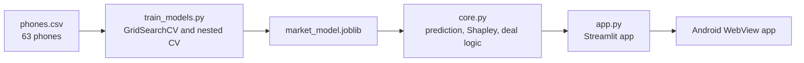

# SpecWorth

*Know what your phone is worth.*

[](https://specworth.streamlit.app/)
[](https://github.com/RishiMishra06/SpecWorth/releases/download/android-latest/SpecWorth.apk)


SpecWorth is a machine learning web app that estimates a smartphone's market price in India from its specifications, tells you whether an offer is a good deal, and recommends the best phones for your budget.

**[Open the live app](https://specworth.streamlit.app/)** · **[Download the Android app](https://github.com/RishiMishra06/SpecWorth/releases/download/android-latest/SpecWorth.apk)** · **[Report a wrong price or bug](https://github.com/RishiMishra06/SpecWorth/issues)**

<table>
  <tr>
    <td width="50%" align="center"><br><sub><b>Predict:</b> a slider and a number box for every spec</sub></td>
    <td width="50%" align="center"><br><sub><b>Result:</b> price, 80% range, Shapley chart, phones near that price</sub></td>
  </tr>
  <tr>
    <td width="50%" align="center"><br><sub><b>Deal check:</b> is the offer fair?</sub></td>
    <td width="50%" align="center"><br><sub><b>Phones:</b> ranked for your budget and priorities</sub></td>
  </tr>
  <tr>
    <td colspan="2" align="center"><br><sub><b>EMI calculator</b> with a tenure comparison</sub></td>
  </tr>
</table>

## Contents
[Why I built it](#why-i-built-it) · [Features](#features) · [How it works](#how-it-works) · [Model performance](#model-performance) · [What I found](#what-i-found) · [Android app](#android-app) · [Run locally](#run-locally) · [Project structure](#project-structure) · [Limitations](#limitations) · [Author](#author)

## Why I built it
I started with a classification model from my Machine Learning training at Winnovation, trained on a Kaggle dataset. It could only name a price class for older phones, so it could not tell what a phone sold in India today should cost. I extended it into a market price estimator trained on current Indian listings, and built the tools around it that a buyer would actually use. The focus was on being honest about how accurate it is.

## Features

| Area | What it does |
|---|---|
| **Predict** | Price in ₹ from RAM, storage, battery, charging, cameras and AnTuTu score, with an 80% prediction interval, a Shapley explanation of every spec's effect, and a PDF report. Every spec has a slider and a number box with ranges that match phones sold today, and RAM and storage move in the sizes real phones come in |
| **Deal check** | Enter the price you are offered. Catalog phones are compared with their listed price, and offers far below it are flagged as *too good to be true*; your own specs are compared with the model's estimate. Visual gauge, better-value alternatives and an EMI calculator |
| **Phones** | Budget (₹5,000 to ₹10 lakh) and priority ranking with filters (brand, 5G, RAM, storage, battery), side-by-side comparison with PDF export, similar phones, value-for-money chart, wishlist, editable catalog |
| **Insights and Models** | Model card, Shapley importance, actual vs predicted plot, cross-validation, live GridSearchCV tuning for the classifiers |
| **Batch** | Upload a CSV to estimate prices or classify price segments in bulk |

## How it works



- **Features:** RAM, storage, battery, charging speed, rear and front camera, AnTuTu benchmark
- **Target:** log of the price, so errors are relative rather than absolute
- **Tuning:** GridSearchCV over trees, depth, learning rate, leaf size and subsampling
- **Explanations:** exact Shapley values over all 2^7 feature coalitions, rescaled to ₹ so they add up to the estimate
- **Prediction interval:** conformal prediction from out-of-sample residuals
- **Persistence:** the trained model is saved with `joblib`; the app retrains automatically if the catalog or library version changes
- **Phone ranking:** a transparent spec-based score (AnTuTu, RAM, storage, battery, charging, camera MP, display size, price) weighted by the priorities you choose

Two models are used:

| Model | Data | Purpose |
|---|---|---|
| Gradient Boosting regression | `phones.csv`: 63 phones sold in India, ₹7,989 to ₹1,94,999 (approx. Oct 2026 prices). 61 are used for training; the 2 foldables are listed but excluded because the fold premium is not explained by specs | Price in ₹ for modern phones |
| Logistic Regression classifier | Kaggle Mobile Price Classification: 2,000 phones, 4 price classes | Price segment, from my Winnovation ML training project |

## Model performance

Regression model, 61 phones:

| Evaluation | R² | Mean absolute error | Average error |
|---|---|---|---|
| Nested cross-validation (6-fold x 2, grid search inside each fold) | 0.81 | about ₹12,000 | about 26% |
| Leave-one-out score of the final tuned model (shown in the app, which retrains on first load, so the last digit can vary) | 0.87 to 0.88 | about ₹9,000 to ₹9,500 | about 21% to 22% |
| Untuned baseline (leave-one-out) | 0.84 | about ₹9,900 | - |

Nested CV is the honest estimate: the hyperparameters were tuned on the same phones, so the leave-one-out score of the tuned model is optimistic.

**The error grows with the price** (nested CV, out-of-fold predictions):

| Price band | Phones | Mean absolute error | Average error |
|---|---|---|---|
| Under ₹15,000 | 14 | about ₹2,600 | 22% |
| ₹15,000 to ₹30,000 | 25 | about ₹5,300 | 22% |
| ₹30,000 to ₹60,000 | 10 | about ₹10,200 | 26% |
| Above ₹60,000 | 12 | about ₹35,200 | 33% |

**Classification models (80/20 split):** Logistic Regression 97.5%, Random Forest 89.25%, KNN 53%. The app can re-tune all three live.

## What I found
- **Tuning did not clearly help.** With about 60 phones, the data is the limit rather than the algorithm.
- **Conformal intervals beat quantile regression.** The 80% conformal interval covered 82% of phones; quantile regression covered only 49%, so it was not used.
- **The processor benchmark matters most.** AnTuTu is the strongest single driver of the price in the Shapley chart.
- **A specs-only model cannot see brand value.** Apple and Samsung flagships come out cheaper than their real price. That is why the deal checker compares catalog phones with their listed price, and flags offers below 60% of it as too good to be true.
- **Budget and mid-range phones are estimated well; premium phones are rough.** Above ₹60,000 there are few phones and brand matters most.

## Android app

The `android-src/` folder holds a small Android app: a full-screen WebView around the live site. A GitHub Actions workflow (`.github/workflows/android.yml`) assembles it into a Gradle project, builds the APK and publishes it to [Releases](https://github.com/RishiMishra06/SpecWorth/releases).

- Handles PDF and CSV downloads, CSV upload in the Batch tab and the back button, and shows an offline page when there is no internet
- It is a wrapper, not a native app: it needs an internet connection, and the first open can show Streamlit's wake-up screen
- The APK is signed with a debug key, so Android asks you to allow installs from unknown sources

## Run locally

```bash
pip install -r requirements.txt
streamlit run app.py
```

Needs `train.csv` (Kaggle Mobile Price Classification) and `phones.csv` in the same folder.

To update the catalog, retrain, and run the tests:

```bash
python train_models.py
pip install pytest
python -m pytest -q
```

## Project structure

```
app.py              Streamlit interface
core.py             Models, scoring, Shapley values, EMI and deal logic (no Streamlit, unit tested)
pdf_report.py       PDF reports (ReportLab)
train_models.py     GridSearchCV + nested CV; saves market_model.joblib and model_card.json
phones.csv          Phone catalog
train.csv           Kaggle dataset used by the classification model
test_core.py        26 unit tests
android-src/        Android WebView app sources
.github/workflows/  tests.yml (pytest) and android.yml (APK build)
docs/               Screenshots
```

## Limitations
- The catalog is hand-collected from public listings (91mobiles, mysmartprice and smartprix, read in Oct 2026). Prices vary by variant and seller, and sources sometimes disagree
- About 60 phones is small, so estimates are indicative, and brand premium (for example Apple) and the fold premium are not captured
- The 5G flag is derived from the chipset and model name
- The phone ranking is a spec-based score, not a review. Megapixels do not measure camera quality

## Tech stack
Python · Pandas · NumPy · scikit-learn · Altair · ReportLab · Streamlit · Android WebView · Gradle · pytest · GitHub Actions

## Author
**Rishi Mishra** ([@RishiMishra06](https://github.com/RishiMishra06))

## License
MIT, see [LICENSE](LICENSE).
